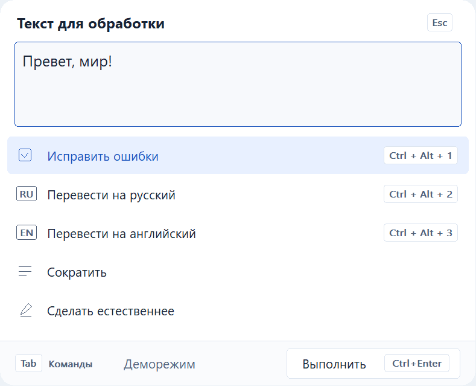

# TextKey для Windows

Исправляйте, переводите и сокращайте текст прямо в приложении, в котором работаете. Можно выделить фрагмент на странице или открыть палитру и написать собственный черновик. Ещё одна команда помогает сделать формулировку естественнее.

**[Скачать TextKey 1.0.0 для Windows x64](https://github.com/LDY55/TextKey/releases/download/v1.0.0/TextKey-1.0.0-windows-x64.zip)** · [Страница релиза и контрольная сумма](https://github.com/LDY55/TextKey/releases/tag/v1.0.0)

В предварительной версии **1.0.1-rc.5** исправлен повторный вызов палитры в Telegram Desktop. Выделите слово в сообщении и нажмите и отпустите `Ctrl+Win+Alt`. В поле набора можно обработать и весь черновик, оставив в нём курсор. Обновление также улучшает чтение выделения в Chrome и добавляет поддержку ячеек Excel. [Скачать 1.0.1-rc.5 для Windows x64](https://github.com/LDY55/TextKey/releases/download/v1.0.1-rc.5/TextKey-1.0.1-rc.5-windows-x64.zip) · [Что изменилось](https://github.com/LDY55/TextKey/releases/tag/v1.0.1-rc.5)

## Первый запуск

1. Распакуйте ZIP в постоянную папку и запустите `TextKey.exe`.
2. В настройках сохраните свой ключ OpenAI или Cerebras. Если указаны оба, TextKey сначала обращается к OpenAI, а при сбое пробует Cerebras. При запуске TextKey проверяет доступные модели короткими тестовыми запросами. Они могут расходовать лимит API.
3. Чтобы попробовать без ключа, запустите `TextKey.exe --demo`. Введите в палитре «Превет, мир!» и нажмите Ctrl+Enter. Демо покажет «Привет, мир!».

## Управление

| Сочетание | Действие |
|---|---|
| Ctrl+Win+Alt, затем отпустить | Открыть палитру с доступным выделением или начать черновик |
| Enter в поле палитры | Добавить строку |
| Ctrl+Enter | Выполнить выбранную команду |
| Tab, затем ↑ или ↓ и Enter | Выбрать и выполнить другую команду |
| Ctrl+Alt+1 / 2 / 3 | Исправить ошибки / перевести на русский / перевести на английский |

В поддерживаемом поле ввода команда может обработать весь текст, если ничего не выделено. В редакторах с проверенной заменой Ctrl+Z возвращает исходный текст после вставки. На страницах для чтения результат можно скопировать. Для черновика кнопка «В редактор» возвращает текст из предпросмотра для дальнейшей правки.

## Обработка текста

Предел одного запроса — 8000 символов. При выполнении команды текст передаётся выбранному сервису обработки. Ключи хранятся в профиле Windows и защищены DPAPI. Деморежим работает локально на подготовленных примерах.
